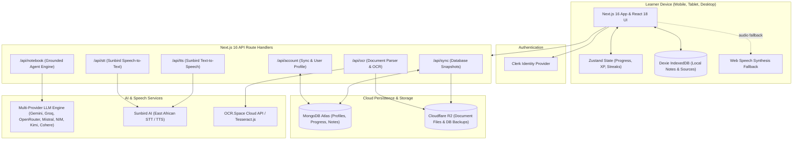
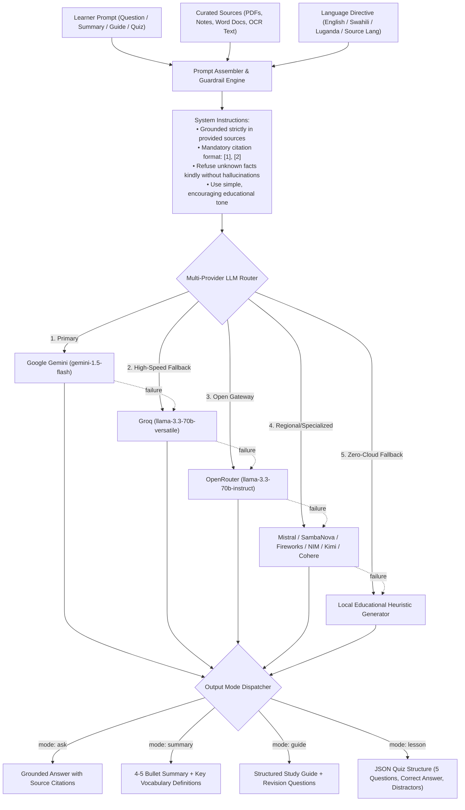
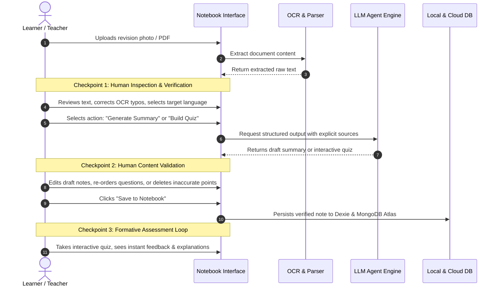

<p align="center">
  
</p>

<h1 align="center">Sautika</h1>

<p align="center">
  <strong>Speak • Learn • Grow</strong><br>
  An AI-assisted, voice-first learning platform and intelligent study assistant designed for learners across East Africa.
</p>

<p align="center">
  <a href="#problem-statement">Problem Statement</a> ·
  <a href="#solution-overview">Solution Overview</a> ·
  <a href="#target-users">Target Users</a> ·
  <a href="#architecture">Architecture</a> ·
  <a href="#technology-stack">Technology Stack</a> ·
  <a href="#agent-architecture">Agent Architecture</a> ·
  <a href="#mcp-implementation">MCP Implementation</a> ·
  <a href="#mcp-toolsservers">MCP Tools</a> ·
  <a href="#human-in-the-loop-workflow">Human-in-the-Loop</a> ·
  <a href="#setup--installation">Setup</a> ·
  <a href="#usage-instructions">Usage</a> ·
  <a href="#limitations">Limitations</a> ·
  <a href="#future-improvements">Roadmap</a>
</p>

---

## Problem Statement

Across East Africa, millions of primary and secondary school learners encounter steep barriers to equitable, high-quality education:

1. **Textbook & Learning Resource Shortages:** Many schools operate with severe student-to-textbook ratios. Students rely heavily on handwritten notebooks or photocopied pamphlets, making revision and self-directed study difficult.
2. **Linguistic Barriers:** While national examinations are administered in English, students frequently conceptualize foundational ideas in regional languages (such as Swahili or Luganda). Mainstream educational platforms lack native support for East African speech accents and indigenous languages.
3. **Connectivity & Device Constraints:** Intermittent internet access, expensive mobile data tariffs, and entry-level mobile devices restrict students from utilizing cloud-heavy modern AI learning software.
4. **Diverse Learning Needs & Reading Difficulties:** Learners with visual impairments, dyslexia, or varied cognitive learning paces are frequently overlooked by rigid, text-dense learning management systems.
5. **Passive Rather Than Active Study:** Passive rereading of notes produces low retention. Learners need interactive study tools—such as instant quizzes, structured summaries, and voice-assisted Q&A—grounded strictly in their actual school syllabus and revision notes.

---

## Solution Overview

**Sautika** (*from the Swahili word for voice/sound*) is an accessible, voice-first learning platform and AI study companion engineered specifically for the East African educational ecosystem. 

Sautika bridges the educational resource gap through:

- **Universal Document Ingestion & OCR:** Learners photograph physical revision sheets or upload Word documents (`.docx`), PDFs, and text files. Sautika extracts the text using cloud OCR and local fallback engines, summarizing key takeaways automatically.
- **Voice-First Regional Interaction:** Powered by Sunbird AI and browser speech synthesis fallbacks, learners can dictate questions and listen to lesson explanations in East African accents and regional languages (Swahili and Luganda).
- **Grounded AI Study Agent:** An intelligent notebook agent that answers questions cited strictly from uploaded sources (`[1]`), synthesizes revision guides, and dynamically generates 5-question interactive quizzes to test comprehension.
- **Offline-Resilient Architecture:** Local caching via Zustand and Dexie (IndexedDB) ensures notes and course progress remain accessible without connectivity, synchronizing seamlessly to MongoDB Atlas when reconnected.
- **Curriculum Alignment:** Preloaded curriculum units covering Baby Class through Senior 6 across Mathematics, Science, English, Social Studies, Agriculture, and Life Skills.
- **Inclusive Accessibility:** Built-in dyslexia-friendly typography (OpenDyslexic, Lexend, Atkinson Hyperlegible), text-to-speech reading assistance, color-tint reading overlays, and high-contrast themes.

---

## Target Users

| User Persona | Key Pain Points | How Sautika Helps |
| --- | --- | --- |
| **Primary & Secondary Students** | Limited revision textbooks, difficult terminology, exam anxiety | Practice interactive quizzes, transform handwritten notes into study guides, listen to pronunciation in regional languages. |
| **Bilingual / ESL Learners** | Conceptualizing in Swahili/Luganda but tested in English | Speech recognition and dual-language audio synthesis provide audio reinforcement in familiar accents. |
| **Learners with Dyslexia & Visual Difficulties** | Eye fatigue, text crowding, difficulty tracking sentences | Dyslexia fonts (OpenDyslexic, Lexend), customizable line spacing, reading tint overlays, and one-click voice narration. |
| **Teachers & Tutors** | Heavy workload preparing custom revision questions and summaries | Instant upload of syllabus notes to generate structured summaries, key vocabulary definitions, and interactive student quizzes. |
| **EdTech Developers & Researchers** | Scarcity of open-source tools tailored for African languages and low-bandwidth resilience | Open extensible architecture featuring Model Context Protocol (MCP) servers and multi-provider LLM failover. |

---

## Architecture

Sautika implements a hybrid client/edge architecture designed for maximum resilience, responsive local interaction, and zero-leak credential security:



### Data and Request Lifecycle

1. **Local-First Interaction:** Client-side updates (lesson completion, streak progression, note creation) write immediately to Zustand and Dexie IndexedDB.
2. **Server-Side Token Verification:** Authenticated requests to `/api/account` validate Clerk JWT sessions server-side before persisting data to MongoDB Atlas.
3. **Universal Document Extraction:** Uploaded PDFs, Word files, or captured photos route to `/api/ocr`. Text is extracted via `pdf-parse`, `mammoth`, or cloud `OCR.Space` (with local `tesseract.js` fallback), stored to Cloudflare R2, and summarized by the LLM engine.
4. **Grounded Agent Processing:** Queries to `/api/notebook` bundle learner sources into prompt context, passing through the multi-provider failover pipeline before returning grounded answers or quiz objects.
5. **Speech Synthesis:** Voice queries stream audio blobs to `/api/stt` for East African speech recognition; text responses can be synthesized into regional speech via `/api/tts`.

---

## Technology Stack

| Category | Technology | Purpose |
| --- | --- | --- |
| **Framework & Runtime** | [Next.js 16 (App Router)](https://nextjs.org/) | Hybrid Server/Client components, dynamic routing, and `proxy.ts` |
| **Frontend Core** | [React 18](https://react.dev/), [TypeScript](https://www.typescriptlang.org/) | Type-safe reactive component tree and view layers |
| **Styling & Layout** | [Tailwind CSS 4](https://tailwindcss.com/) | Responsive layouts, CSS variable tokens, and dark/light mode themes |
| **Icons & Assets** | [Lucide React](https://lucide.dev/) | Clean, accessible vector interface iconography |
| **Typography & A11y** | [@fontsource](https://fontsource.org/) | Embedded dyslexia-accessible typefaces (OpenDyslexic, Lexend, Atkinson Hyperlegible, Comic Neue) |
| **Local Client State** | [Zustand](https://github.com/pmndrs/zustand) | Persisted reactive store for streaks, coin rewards, XP, and settings |
| **Client Database** | [Dexie.js](https://dexie.org/) (IndexedDB) | Device-local storage and offline caching of study documents and notebook items |
| **Authentication** | [Clerk](https://clerk.com/) (`@clerk/nextjs`) | Multi-factor user identity, session management, and protected routes |
| **Cloud Database** | [MongoDB Atlas](https://www.mongodb.com/atlas) (`mongodb`) | Cloud persistence of user profiles, progress, notes, and coin history |
| **Object Storage & Backup** | [Cloudflare R2](https://www.cloudflare.com/developer-platform/r2/) (`@aws-sdk/client-s3`) | S3-compatible cloud storage for uploaded documents and automated database sync snapshots |
| **Document Parsers** | `mammoth`, `pdf-parse` | Server-side text extraction from Microsoft Word documents and PDF files |
| **OCR Engines** | `OCR.Space API`, `tesseract.js` | Cloud API and local WebAssembly fallback for extracting text from note photos |
| **Speech Services** | [Sunbird AI](https://sunbird.ai/) & Web Speech API | East African regional speech-to-text (`/api/stt`) and text-to-speech (`/api/tts`) |
| **LLM Inference Engine** | Multi-Provider Failover Router | Resilient multi-tier routing across Google Gemini, Groq, OpenRouter, Mistral, SambaNova, Fireworks, NVIDIA NIM, Kimi, Zhipu, and Cohere |
| **AI Tooling Protocol** | [Model Context Protocol (MCP)](https://modelcontextprotocol.io/) | Stdio JSON-RPC MCP server connecting AI development agents to Sautika's OCR tools |

---

## Agent Architecture

Sautika features a specialized **Grounded Educational Agent** embedded within the Learning Notebook (`/api/notebook` and `src/lib/llmProviders.ts`). The agent acts as an encouraging, patient tutor dedicated to East African learners.



### Agent Modes

1. **`ask` (Interactive Grounded Q&A):** Answers questions posed by the learner. Constrained strictly to the uploaded texts to prevent hallucinations, formatting citations as `[Source 1]`.
2. **`summary` (Digest Generation):** Distills complex chapters or document scans into 4–5 bullet points accompanied by 3 key vocabulary definitions suited for school-age comprehension.
3. **`guide` (Comprehensive Study Guide):** Generates a structured breakdown comprising 4 key concepts, 4 core terms with explanations, and 2 practice questions.
4. **`lesson` (Interactive Quiz Synthesis):** Emits strict JSON schemas containing 5 multiple-choice questions with answer keys and plausible distractors to convert any text into an interactive test player.

---

## MCP Implementation

Sautika integrates the **[Model Context Protocol (MCP)](https://modelcontextprotocol.io/)**, an open standard enabling AI assistants (such as Google Antigravity, Claude Desktop, or Cursor) to securely interface with local and external development tools.

Sautika exposes an MCP server implementation over `stdio` transport using JSON-RPC 2.0 located at [`scripts/mcp-ocr-server.mjs`](./scripts/mcp-ocr-server.mjs).

### Configuration

Sautika registers the MCP server in the workspace configuration files:
- [`.agents/mcp_config.json`](./.agents/mcp_config.json)
- [`.agents/plugins/ocr-service/mcp_config.json`](./.agents/plugins/ocr-service/mcp_config.json)

```json
{
  "mcpServers": {
    "ocr-space": {
      "command": "node",
      "args": ["./scripts/mcp-ocr-server.mjs"]
    }
  }
}
```

When an agentic IDE or AI assistant launches the workspace, the MCP server initializes automatically and registers Sautika's document extraction tools into the agent's runtime tool registry.

---

## MCP Tools/Servers

### Server: `ocr-space` (`ocr-space-mcp-server` v1.0.0)

- **Transport:** Standard Input/Output (`stdio`)
- **Protocol:** JSON-RPC 2.0 (MCP Protocol Version `2024-11-05`)
- **Location:** [`scripts/mcp-ocr-server.mjs`](./scripts/mcp-ocr-server.mjs)

### Available Tool: `ocr_extract_text`

Extracts text from images, photos of revision notes, or diagrams using the OCR cloud engine with automatic format normalization.

#### Input Schema

| Parameter | Type | Required | Default | Description |
| --- | --- | --- | --- | --- |
| `image` | `string` | **Yes** | — | Target image to parse. Accepts an absolute or relative local file path, a public HTTP/HTTPS URL, or a base64 Data URI string. |
| `language` | `string` | No | `"eng"` | Recognition language code (e.g. `eng` for English, `swa` for Swahili, `fre` for French, `spa` for Spanish). |

#### JSON-RPC Invocation Example

```json
{
  "jsonrpc": "2.0",
  "id": 1,
  "method": "tools/call",
  "params": {
    "name": "ocr_extract_text",
    "arguments": {
      "image": "./public/samples/notes-sample.jpg",
      "language": "eng"
    }
  }
}
```

#### Successful Tool Response

```json
{
  "jsonrpc": "2.0",
  "id": 1,
  "result": {
    "content": [
      {
        "type": "text",
        "text": "Photosynthesis is the process by which green plants use sunlight to synthesize nutrients..."
      }
    ]
  }
}
```

---

## Human-in-the-Loop Workflow

Sautika is intentionally built around **learner and educator agency**. Rather than acting as an unguided autonomous agent, the platform enforces human-in-the-loop checkpoints across all AI workflows:



### Key Principles

1. **Explicit Source Curation:** The learner controls exactly which files and study units are supplied as grounding context. The agent never browses external unverified sources without instruction.
2. **Transparent Citations:** Answers to specific questions reference `[Source X]`, allowing learners and teachers to immediately cross-reference the answer with their original notes.
3. **Editable Drafts:** OCR extractions and AI-generated summaries open in editable text fields. Learners can modify, supplement, or rewrite points prior to saving.
4. **Safety and Fallback Guardrails:** If requested knowledge is absent from the user's provided notes, the agent is instructed to state that the material is not in the source rather than guessing or hallucinating facts.

---

## Setup / Installation

### Prerequisites

- **Node.js:** `20.9.0` or higher
- **npm:** Package manager bundled with Node
- **MongoDB Atlas Cluster** (or local MongoDB instance)
- **mongosh:** (MongoDB Shell, optional for running initial schema scripts)

### Installation Steps

1. **Clone the repository:**
   ```bash
   git clone https://github.com/marthanp/sautika.git sautika-next
   cd sautika-next
   ```

2. **Install project dependencies:**
   ```bash
   npm install
   ```

3. **Configure Environment Variables:**
   Copy the example environment template:
   ```bash
   # Linux / macOS
   cp .env.example .env.local

   # Windows PowerShell
   Copy-Item .env.example .env.local
   ```
   Open `.env.local` and add your service credentials (see table below).

4. **Initialize MongoDB Database Schema:**
   *(Optional but recommended)* Run the database setup script to configure indexes and collection validators:
   ```powershell
   # Windows PowerShell
   $env:MONGODB_URI = "mongodb+srv://<username>:<password>@<cluster>.mongodb.net/?retryWrites=true&w=majority"
   mongosh "$env:MONGODB_URI" --file .\database\sautika.mongodb.js
   ```

5. **Start the Development Server:**
   ```bash
   npm run dev
   ```
   Open [http://localhost:3000](http://localhost:3000) in your browser.

---

### Environment Variables

| Variable | Description | Required? |
| --- | --- | --- |
| `NEXT_PUBLIC_CLERK_PUBLISHABLE_KEY` | Clerk authentication publishable key | Yes |
| `CLERK_SECRET_KEY` | Clerk backend secret key | Yes |
| `MONGODB_URI` / `MONGO_URI` | MongoDB Atlas connection string | Yes |
| `R2_ENDPOINT` | Cloudflare R2 S3 endpoint (`https://<account-id>.r2.cloudflarestorage.com`) | Optional |
| `R2_ACCESS_KEY_ID` | Cloudflare R2 Access Key ID | Optional |
| `R2_SECRET_ACCESS_KEY` | Cloudflare R2 Secret Access Key | Optional |
| `R2_BUCKET_NAME` | Cloudflare R2 bucket name (default: `sautika-media`) | Optional |
| `R2_PUBLIC_URL` | Public access URL for stored documents (e.g., `https://pub-<id>.r2.dev`) | Optional |
| `SUNBIRD_API_KEY` | Sunbird AI token for regional voice STT/TTS | Optional |
| `OCR_SPACE_API_KEY` | Primary API key for OCR.Space cloud document extraction | Optional |
| `OCR_SPACE_API_KEY_FALLBACK` | Secondary API key for OCR.Space | Optional |
| `GEMINI_API_KEY` / `GOOGLE_API_KEY` | Google Gemini API key for notebook AI tutor | Optional |
| `GROQ_API_KEY` | Groq API key for high-speed Llama-3.3 inference | Optional |
| `OPENROUTER_API_KEY` | OpenRouter API key for backup multi-model routing | Optional |
| `MISTRAL_API_KEY` | Mistral AI API key for failover | Optional |

> **Note:** Sautika includes built-in heuristic fallbacks for LLM operations, browser Web Speech fallback for voice synthesis, and local `tesseract.js` for OCR. The application runs smoothly in development even with a minimal set of API keys.

---

## Usage Instructions

### 1. Curriculum Exploration & Quizzes
- Navigate to **Courses** from the sidebar.
- Filter by grade level (from **Baby Class** up to **Senior 6**) and subject (**Mathematics**, **Science**, **English**, **Social Studies**, **Agriculture**, **Life Skills**).
- Click any course card to launch the **Lesson Player**.
- Complete multiple-choice exercises, receive immediate audio and visual feedback, and earn XP and learning coins.

### 2. Universal Document Upload & OCR
- Go to **Notebook** and click **Upload File** (or drag and drop a file).
- Supported formats:
  - **Photos of handwritten or textbook notes:** `.png`, `.jpg`, `.jpeg`, `.webp`
  - **Documents:** `.pdf`, `.docx`
  - **Plain Text:** `.txt`, `.md`, `.csv`, `.json`
- Sautika extracts the text, saves a backup copy to Cloudflare R2, and displays an editable note draft.

### 3. AI Notebook & Study Assistant
- Open any note in your Notebook.
- Choose an action from the action toolbar:
  - **Summarize:** Creates 4–5 bullet points highlighting core ideas and 3 vocabulary terms.
  - **Study Guide:** Formats 4 key concepts, explanations, and practice questions.
  - **Generate Quiz:** Creates a 5-question interactive quiz directly from the content.
  - **Ask Question:** Type any question regarding the note; the agent responds with citations referencing `[Source 1]`.

### 4. Voice Interaction & Regional Speech
- Click the microphone icon to speak your question using Sunbird AI speech-to-text.
- Click the speaker icon on any note, question, or vocabulary term to hear audio synthesis in regional languages (Luganda, Swahili, or English).

### 5. Tracking Progress & Accessibility Customization
- Visit **Progress** to review learning streaks, subject mastery breakdowns, and earned badges.
- Visit **Settings** to adjust font scale, letter spacing, line height, contrast mode, dyslexia-friendly fonts, or reading tint overlays.

---

## Available Scripts

| Command | Description |
| --- | --- |
| `npm run dev` | Starts local Next.js dev server with Turbopack |
| `npm run build` | Builds optimized production bundle |
| `npm run start` | Starts production server |
| `npm run typecheck` | Validates TypeScript types across the project |
| `npm run lint` | Runs ESLint code style and quality checks |

---

## Limitations

- **Handwriting Legibility:** Highly cursive, faint, or low-resolution photographs of handwritten notes may require manual correction after OCR extraction.
- **Regional Dialect Breadth:** While Sunbird AI provides state-of-the-art coverage for Swahili and Luganda, smaller East African dialects currently rely on English or Swahili phonetic synthesis.
- **Internet Dependency for Full Voice:** High-quality regional voice synthesis requires an active connection to Sunbird AI; offline devices fall back to the browser's built-in Web Speech voices.
- **Token Quotas on Free LLM Tiers:** Heavy concurrent usage of external AI providers may exceed rate limits, though Sautika mitigates this via multi-provider failover and heuristic generators.

---

## Future Improvements

- [ ] **Curriculum Semantic Search:** Integration of PostgreSQL with `pgvector` for semantic syllabus retrieval across East African national curriculum textbooks.
- [ ] **Progressive Web App (PWA):** Service worker offline caching and installation onto Android and low-cost smartphones.
- [ ] **On-Device Edge AI:** Integration of WebLLM or compact on-device models to provide offline summaries and quiz generation without requiring cloud API calls.
- [ ] **Classroom & Teacher Dashboard:** Group assignment distribution, class analytics, and synchronized offline homework grading.
- [ ] **Additional Regional Languages:** Extending speech-to-text and text-to-speech models to include Runyankole, Acholi, and Ateso.

---

## Maintainers

Sautika is designed and maintained by:

- **NATOZO PATIENCE MARTHA**
- **EGABO AARON**
- **ONYANGO JOHN STEVEN**

---

## License

This project is licensed under the [MIT License](./LICENSE).
