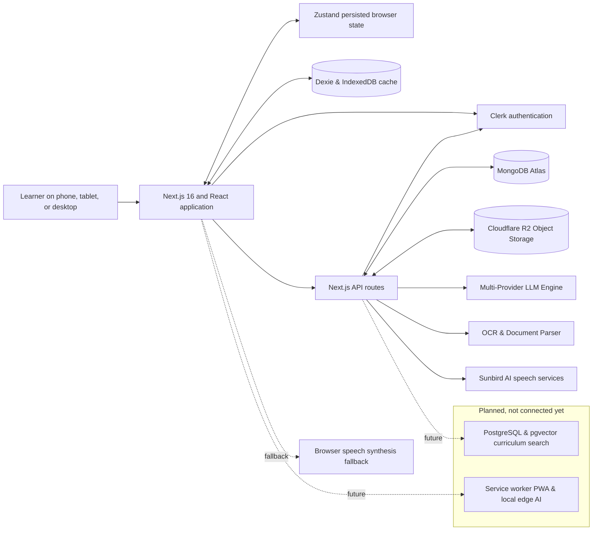

<p align="center">
  
</p>

<h1 align="center">Sautika</h1>

<p align="center">
  <strong>Speak • Learn • Grow</strong><br>
  A voice-first learning platform designed for learners in East Africa.
</p>

<p align="center">
  <a href="#overview">Overview</a> ·
  <a href="#features">Features</a> ·
  <a href="#technology">Technology</a> ·
  <a href="#architecture">Architecture</a> ·
  <a href="#installation">Installation</a> ·
  <a href="#maintainers">Maintainers</a>
</p>

---

## Overview

Sautika is an AI-assisted, voice-first learning platform designed for primary and secondary school learners across East Africa. It brings interactive curriculum lessons, multi-format document study tools, regional voice interaction, and cloud synchronization together in a responsive web application.

Learners can explore standard curriculum courses, work through interactive multiple-choice and sentence-building exercises, upload study documents (PDFs, Word docs, photos of notes) for OCR and instant AI summaries, and practice with speech recognition and audio synthesis in regional languages like Luganda and Swahili.

## Features

- **Explore and practise:** Browse subject areas (Mathematics, Science, English, Social Studies, Agriculture, Life Skills) across education levels (Baby Class through Senior 6) and work through interactive exercises.
- **Learn with voice:** Record spoken questions with Sunbird AI speech-to-text, and listen to synthesized lesson explanations in regional languages with automatic Web Speech fallback.
- **Universal document study:** Upload study materials in multiple formats—plain text, Markdown, PDF documents (via `pdf-parse`), Microsoft Word files (`.docx` via `mammoth`), and photos or scanned documents (via `OCR.Space` and `Tesseract.js`).
- **AI-powered notebook:** Ask questions grounded strictly in uploaded study sources, generate concise bullet-point summaries, create structured study guides, or generate custom interactive practice quizzes using Sautika's multi-provider LLM engine.
- **Keep learning progress:** Track completed lessons, coin rewards, experience points (XP), daily streaks, and accessibility preferences with local offline caching (Zustand & Dexie) and cloud synchronization to MongoDB Atlas for signed-in learners.
- **Cloud media storage & backup:** Store uploaded study documents and periodically export MongoDB collection snapshots directly to Cloudflare R2 object storage.
- **Inclusive accessibility:** Customize font sizing, line height, letter spacing, contrast modes, reading tint overlays, and dyslexia-friendly typography (OpenDyslexic, Lexend, Atkinson Hyperlegible, Comic Neue).
- **Responsive design:** Optimized for mobile phones, tablets, and desktop workstations.

> **Current implementation:** Clerk manages user identity and authentication. MongoDB Atlas persists learner profiles, course progress, user settings, notebook sources, and notes. Cloudflare R2 stores uploaded documents and database snapshots. A multi-provider LLM engine routes notebook AI requests across active providers (Gemini, Groq, OpenRouter, Mistral, SambaNova, Fireworks, NVIDIA NIM, Kimi, Zhipu, Cohere) with a local educational heuristic fallback. Regional speech recognition and voice playback are powered by Sunbird AI.

## Technology

### Used today

| Area | Technology | Role |
| --- | --- | --- |
| Web framework and routing | Next.js 16 App Router | Server components, dynamic routes, and Next 16 `proxy.ts` |
| UI | React 18 and TypeScript | Reusable, typed UI components and responsive views |
| Styling | Tailwind CSS 4 | Modern responsive layouts, accessibility themes, and dark/light modes |
| Icons | Lucide React | Interface iconography |
| Typography & Accessibility | Fontsource | Dyslexia-friendly fonts (OpenDyslexic, Lexend, Atkinson Hyperlegible, Comic Neue) |
| Local learner state | Zustand with persistence | Course activity, progress, preferences, and session state in the browser |
| Local notebook storage | Dexie & IndexedDB | Device-local caching of study sources and notes |
| Account authentication | Clerk (`@clerk/nextjs`) | Authenticated learner identity, middleware protection, and user metadata |
| Cloud database | MongoDB Atlas (`mongodb`) | Cloud persistence of profiles, progress, settings, notes, and coin transactions |
| Object storage & backups | Cloudflare R2 (`@aws-sdk/client-s3`) | S3-compatible cloud storage for uploaded documents and database sync archives |
| Document parsing & OCR | `mammoth`, `pdf-parse`, `OCR.Space`, `tesseract.js` | Text extraction from Word documents, PDFs, and printed/handwritten images |
| Notebook AI & LLM Engine | Multi-Provider Failover Engine | Smart failover across Google Gemini, Groq, OpenRouter, Mistral, SambaNova, Fireworks, NVIDIA NIM, Moonshot Kimi, Zhipu ZAI, Cohere, and local fallback |
| Speech services | Sunbird AI API | East African Speech-to-Text (`/api/stt`) and Text-to-Speech (`/api/tts`) |
| Speech fallback | Web Speech API | Browser text-to-speech fallback when offline or external voices are unavailable |
| Tooling & MCP | Model Context Protocol | Standalone stdio MCP server for OCR extraction (`scripts/mcp-ocr-server.mjs`) |

### Planned additions

These are roadmap items for future iterations:

- **pgvector-powered curriculum search** for semantic retrieval and question-answering across approved regional syllabus textbooks.
- **Service worker & offline PWA support** for installability and complete offline capability on low-cost devices.
- **Local edge LLM runtime (e.g. Ollama or WebLLM)** for generating summaries and quizzes without an internet connection.

## Architecture

The application uses the browser for its interactive UI, local state, and offline Dexie database. Sensitive operations and external API requests go through Next.js server route handlers, keeping all API keys secure on the server.



### Request and data flow

1. **Rendering & Local State:** The browser renders the interface and manages client-side progress using Zustand (persisted to `localStorage`) and study sources in IndexedDB via Dexie.
2. **Authentication:** Clerk verifies learner identity. Route handlers (such as `/api/account`) validate the session token server-side and isolate data by the authenticated user ID.
3. **Data Synchronization:** Learner progress, XP, streaks, notes, and custom settings sync to MongoDB Atlas via `/api/account`. If offline, changes remain queued locally and sync when reconnected.
4. **Document Processing & OCR:** When a learner uploads a study file (PDF, Word document, or image), `/api/ocr` extracts clean text using format-specific engines (`pdf-parse`, `mammoth`, or `OCR.Space` cloud API with `Tesseract.js` fallback), stores the original file in Cloudflare R2, and generates an initial summary.
5. **AI Notebook Operations:** For summaries, Q&A, study guides, and quiz generation, `/api/notebook` queries the multi-provider LLM engine (`src/lib/llmProviders.ts`). The engine attempts configured providers in order of latency and capability (Google Gemini, Groq, OpenRouter, Mistral, SambaNova, Fireworks, NVIDIA NIM, Kimi, Zhipu, Cohere) before falling back to its built-in educational heuristic generator.
6. **Voice Synthesis & Transcription:** Voice queries are sent as audio blobs to `/api/stt` for Sunbird AI transcription. Text synthesis requests to `/api/tts` return Sunbird audio URLs with fallback to the browser's Web Speech API.
7. **Cloud Snapshot Sync:** `/api/sync` provides health checks for MongoDB and Cloudflare R2, enabling automated or manual snapshot exports of collections to R2 for backup and edge delivery.

## Who Sautika is for

- **Learners** who want short, interactive practice and a simple way to review study notes.
- **Learners studying in East African contexts** who benefit from local examples and language-aware learning tools.
- **Teachers and learning-program teams** who want to explore voice-enabled, AI-assisted learning workflows and build on the existing course and notebook foundations.
- **Developers and contributors** interested in accessible education technology, local-language support, and offline-capable web applications.

## Installation

### Requirements

- Node.js **20.9.0 or later**
- npm
- API credentials for the services you intend to use (see [Environment variables](#environment-variables))

### Get started

```bash
git clone <repository-url> sautika-next
cd sautika-next
npm install
```

Create a local environment file from the template:

```bash
# macOS / Linux
cp .env.example .env.local
```

```powershell
# Windows PowerShell
Copy-Item .env.example .env.local
```

Configure your credentials in `.env.local` or `.env`.

To set up MongoDB:

1. Create a MongoDB Atlas cluster and database user. In Atlas, navigate to **Security** > **Network Access** and ensure your IP address is whitelisted (or use `0.0.0.0/0` for development).
2. Set `MONGODB_URI` in `.env.local`. Keep this URI private and never prefix it with `NEXT_PUBLIC_`.
3. Install the MongoDB Shell (`mongosh`) if not already available, and initialize the database schema, indexes, and validators:

   ```powershell
   $env:MONGODB_URI = "mongodb+srv://<username>:<password>@<cluster-host>/?retryWrites=true&w=majority"
   mongosh "$env:MONGODB_URI" --file .\database\sautika.mongodb.js
   ```

4. Start the development server:

```bash
npm run dev
```

Open [http://localhost:3000](http://localhost:3000).

### Environment variables

| Variable | Required for | Notes |
| --- | --- | --- |
| `NEXT_PUBLIC_CLERK_PUBLISHABLE_KEY` | Clerk Authentication | Public Clerk publishable key from your Clerk Dashboard. |
| `CLERK_SECRET_KEY` | Server-Side Auth | Private Clerk secret key used by route handlers and middleware. |
| `MONGODB_URI` (or `MONGO_URI`) | Cloud Database | MongoDB connection string. Keep server-only. |
| `R2_ENDPOINT` | Media & Backup Storage | Cloudflare R2 S3 endpoint (`https://<account-id>.r2.cloudflarestorage.com`). |
| `R2_ACCESS_KEY_ID` | R2 Authentication | 32-character hexadecimal R2 Access Key ID. |
| `R2_SECRET_ACCESS_KEY` | R2 Authentication | 64-character hexadecimal R2 Secret Access Key. |
| `R2_BUCKET_NAME` | R2 Bucket Name | Name of your R2 bucket (defaults to `sautika-media`). |
| `R2_PUBLIC_URL` | Media Access | Public R2 URL base (e.g. `https://pub-<id>.r2.dev`). |
| `SUNBIRD_API_KEY` | Speech Services | Sunbird AI token for regional speech-to-text and text-to-speech. |
| `SUNBIRD_API_URL` | Sunbird Endpoint | Optional base URL (defaults to `https://api.sunbird.ai`). |
| `OCR_SPACE_API_KEY` | Document OCR | Server-side key for OCR.Space cloud extraction. |
| `OCR_SPACE_API_KEY_FALLBACK` | Secondary OCR Key | Backup key for OCR.Space cloud extraction. |
| `GEMINI_API_KEY` / `GOOGLE_API_KEY` | Notebook AI Engine | Google Gemini API key for summaries, Q&A, and quiz generation. |
| `GROQ_API_KEY` | Notebook AI Engine | Groq high-speed Llama inference. |
| `OPENROUTER_API_KEY` | Notebook AI Engine | OpenRouter multi-model inference. |
| `MISTRAL_API_KEY` / `FIREWORKS_API_KEY` / etc. | Notebook AI Engine | Additional provider keys for automatic failover. |

Keep all credentials in `.env.local` or `.env`, which are ignored by Git. Never commit production credentials or expose private keys to `NEXT_PUBLIC_*` variables.

### Available scripts

| Command | Description |
| --- | --- |
| `npm run dev` | Start the local development server with Turbopack. |
| `npm run typecheck` | Run the TypeScript compiler (`tsc --noEmit`) to verify types. |
| `npm run lint` | Run ESLint to validate code quality and style conventions. |
| `npm run build` | Compile and generate an optimized production build. |
| `npm run start` | Start the production Next.js server after building. |

For a production run:

```bash
npm run build
npm run start
```

## Project structure

```text
public/                  Logo, icons, artwork, and course illustrations
scripts/
  mcp-ocr-server.mjs     Model Context Protocol stdio server for OCR extraction
database/
  sautika.mongodb.js     MongoDB collection schemas, validators, and indexes
src/
  app/
    (app)/               Learner application routes:
      home/              Dashboard overview, quick continue, and activity
      courses/           Curriculum explorer with grade and subject filters
      learning/          Interactive quiz and lesson player
      notebook/          AI study notebook, document uploads, and Q&A
      progress/          XP tracking, learning streaks, and subject mastery
      rewards/           Coin catalog and study badge redemptions
      settings/          Accessibility, themes, fonts, and display preferences
    api/
      account/           Server-side learner profile, progress, notes, and coins
      notebook/          AI-backed notebook questions, summaries, and quizzes
      ocr/               Universal document extraction (PDF, Word, Images, OCR)
      stt/               Sunbird AI speech-to-text transcription
      tts/               Sunbird AI text-to-speech audio synthesis
      sync/              MongoDB to Cloudflare R2 backup status and sync trigger
    globals.css          Global styles, accessibility themes, and Tailwind tokens
    layout.tsx           Root document layout and Clerk authentication provider
    page.tsx             Public landing page
    proxy.ts             Next.js 16 server request proxy (middleware)
  components/            Modular UI components (Sidebar, Topbar, LessonPlayer, etc.)
  data/courses.ts        Curriculum definitions and structured lesson units
  lib/
    config.ts            Centralized server configuration and key diagnostics
    data.ts              Core application data, subjects, and reward definitions
    db.ts                Dexie IndexedDB database client
    llmProviders.ts      Multi-provider AI LLM failover engine
    mongodb.ts           MongoDB Atlas connection pooling
    r2.ts                Cloudflare R2 S3 storage client and sync utilities
    useVoice.ts          Web Speech and Sunbird AI voice integration hook
  store/useApp.ts        Zustand persisted learner state store
  types/                 Shared TypeScript interfaces and types
.env.example             Environment variable template with configuration notes
```

## Maintainers

Sautika is made and maintained by:

- **NATOZO PATIENCE MARTHA**
- **EGABO AARON**
- **ONYANGO JOHN STEVEN**

## License

This project is licensed under the [MIT License](./LICENSE).
