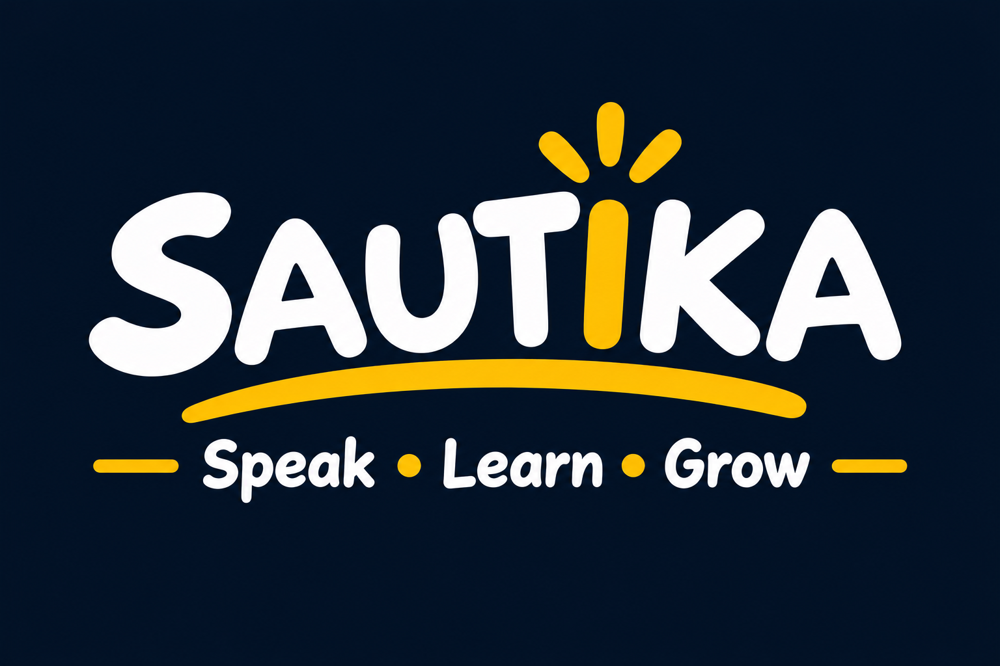
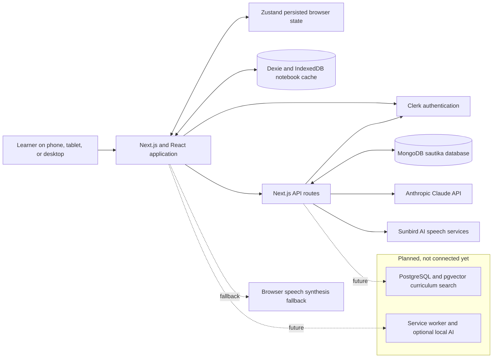

<p align="center">
  
</p>

<h1 align="center">Sautika</h1>

<p align="center">
  <strong>Speak • Learn • Grow</strong><br>
  A voice-first learning platform designed for learners in East Africa.
</p>

<p align="center">
  <a href="#overview">Overview</a> ·
  <a href="#features">Features</a> ·
  <a href="#technology">Technology</a> ·
  <a href="#architecture">Architecture</a> ·
  <a href="#installation">Installation</a> ·
  <a href="#maintainers">Maintainers</a>
</p>

---

## Overview

Sautika is an AI-assisted learning experience for primary and secondary school learners. It brings lessons, study tools, and voice interactions together in a responsive web application, with a focus on making learning more accessible in East African languages.

Learners can explore courses, work through interactive lessons, ask questions about their own study materials, and keep track of their learning activity. The interface is designed for phones, tablets, and desktop computers.

## Features

- **Explore and practise:** Browse subject areas and work through interactive multiple-choice and word-building exercises.
- **Learn with voice:** Record spoken questions for transcription and listen to text using connected speech services or supported browser voices.
- **Study with your own materials:** Add or upload text sources to a notebook, then request answers, summaries, study guides, or practice questions based on those sources.
- **Keep learning progress:** Track course activity, experience points, streaks, and accessibility preferences locally and sync them to MongoDB for the signed-in learner.
- **Stay organized:** Notebook sources remain available in IndexedDB and sync to the signed-in learner's MongoDB account; notes are stored in MongoDB.
- **Learn in a responsive interface:** Use the application on mobile, tablet, or desktop screen sizes.

> **Current implementation:** Clerk manages sign-in and user identity. MongoDB stores learner profiles, progress, settings, notebook sources, and notes when `MONGODB_URI` is configured and the schema script has been run. Some dashboard figures and catalog content are still sample data. Speech integrations are present, but their request and response fields should be verified against the current Sunbird AI API documentation before production use.

## Technology

### Used today

| Area | Technology | Role |
| --- | --- | --- |
| Web framework and routing | Next.js 16 App Router | Pages, layouts, static assets, and server API routes |
| UI | React 18 and TypeScript | Reusable components and typed application logic |
| Styling | Tailwind CSS 4 | Responsive layouts and visual styling |
| Icons | Lucide React | Interface iconography |
| Local learner state | Zustand with persistence | Course activity, progress, preferences, and session state in the browser |
| Local notebook storage | Dexie and IndexedDB | Learner-created notebook sources stored on the device |
| Account authentication | Clerk | Authenticated learner identity and protected app/API routes |
| Cloud learner storage | MongoDB Node.js driver | Server-side learner profile, state, settings, notes, and notebook source persistence |
| Notebook AI | Anthropic SDK / Claude Messages API | Source-grounded answers, summaries, study guides, and generated practice lessons |
| Speech services | Sunbird AI API routes | Speech-to-text and text-to-speech integration |
| Speech fallback | Web Speech API | Browser text-to-speech fallback where a suitable voice is available |

### Planned additions

These are roadmap items, not dependencies or features that are already active in the application:

- **Supabase and PostgreSQL** for curriculum search and pgvector-backed content retrieval.
- **pgvector-powered curriculum search** for retrieval from approved learning materials.
- **A service worker and full offline PWA support** for installability and broader offline access.
- **An optional local model (such as Ollama)** to explore AI assistance without a network connection.
- **PDF import and text extraction** for adding more types of study material.

## Architecture

The current application uses the browser for its interactive UI and device-local learner data. Requests that require API credentials go through Next.js route handlers, keeping provider keys on the server.



### Request and data flow

1. The browser renders the learning interface and manages interactive state.
2. Clerk authenticates the learner. `/api/account` checks that identity server-side and only reads or writes records owned by that Clerk user.
3. Learner progress and preferences sync through `/api/account` to MongoDB; notebook sources also remain cached in that learner's IndexedDB partition. Notes are stored in MongoDB.
4. For notebook AI tasks, the browser sends the selected sources and task to `/api/notebook`. The server calls the multi-provider LLM engine with automatic fallback (Google Gemini, Groq, OpenRouter, Mistral, SambaNova, Fireworks, Cohere, etc.).
5. Voice requests go through `/api/stt` or `/api/tts`. These server routes use `SUNBIRD_API_KEY`; text-to-speech can fall back to browser speech synthesis where supported.
6. Curriculum retrieval and a full offline runtime are not connected in the current code.

## Who Sautika is for

- **Learners** who want short, interactive practice and a simple way to review study notes.
- **Learners studying in East African contexts** who benefit from local examples and language-aware learning tools.
- **Teachers and learning-program teams** who want to explore voice-enabled, AI-assisted learning workflows and build on the existing course and notebook foundations.
- **Developers and contributors** interested in accessible education technology, local-language support, and offline-capable web applications.

## Installation

### Requirements

- Node.js **20.9.0 or later**
- npm
- API credentials for the services you intend to use (see [Environment variables](#environment-variables))

### Get started

```bash
git clone <repository-url> sautika-next
cd sautika-next
npm install
```

Create a local environment file from the example:

```bash
# macOS / Linux
cp .env.example .env.local
```

```powershell
# Windows PowerShell
Copy-Item .env.example .env.local
```

Configure Clerk, MongoDB, and any optional AI or speech keys in `.env.local`. To enable MongoDB:

1. Create a MongoDB Atlas cluster and database user. Add your current IP address to Atlas **Network Access**.
2. Copy the Atlas connection string and set `MONGODB_URI` in `.env.local`. Replace the username, password, and cluster host; URL-encode special characters in the password. Keep this URI private and never prefix it with `NEXT_PUBLIC_`.
3. Install MongoDB Shell (`mongosh`) if it is not installed. In PowerShell, set the URI for that terminal session and run the schema:

   ```powershell
   $env:MONGODB_URI = "mongodb+srv://<username>:<password>@<cluster-host>/?retryWrites=true&w=majority"
   mongosh "$env:MONGODB_URI" --file .\database\sautika.mongodb.js
   ```

   The script creates the `sautika` database's collections, validators, and indexes. It is safe to rerun. Do not paste a real database URI into source control or chat.
4. Restart the Next.js server after changing `.env.local`. The app will create or update the signed-in learner's profile and sync app data when they open a protected page.

Then start the development server:

```bash
npm run dev
```

Open [http://localhost:3000](http://localhost:3000).

### Environment variables

| Variable | Required for | Notes |
| --- | --- | --- |
| `NEXT_PUBLIC_CLERK_PUBLISHABLE_KEY` | Sign-in and Clerk UI | Public Clerk instance key from the Clerk Dashboard. |
| `CLERK_SECRET_KEY` | Server-side authentication | Secret Clerk key. Keep it server-only. |
| `MONGODB_URI` or `MONGO_URI` | Cloud learner storage | Private MongoDB URI used only by server routes. Run the schema script after creating the database. `MONGODB_URI` is preferred; `MONGO_URI` is accepted for compatibility. |
| `OCR_SPACE_API_KEY` | Document & Image OCR | Server-side key for OCR.Space cloud extraction with local fallback. |
| `OCR_SPACE_API_KEY_FALLBACK` | Secondary OCR Key | Backup key for OCR.Space cloud extraction. |
| `GEMINI_API_KEY` / `GROQ_API_KEY` / etc. | Notebook AI & Summaries | Multi-provider LLM failover keys (Google Gemini, Groq, OpenRouter, Mistral, etc.). |
| `SUNBIRD_API_KEY` | Speech-to-text and text-to-speech | Server-side key used by `/api/stt` and `/api/tts`. |
| `SUNBIRD_API_URL` | Sunbird AI | Optional base URL; defaults to `https://api.sunbird.ai`. |

The Supabase values in `.env.example` are placeholders for planned work; they are not needed to run the current app. Clerk and MongoDB credentials are required for authenticated cloud sync. Keep real credentials in `.env.local`, which is ignored by Git. Do not add secrets to `NEXT_PUBLIC_*` variables.

### Available scripts

| Command | Description |
| --- | --- |
| `npm run dev` | Start the local development server. |
| `npm run typecheck` | Run the TypeScript compiler without emitting files. |
| `npm run build` | Create a production build. |
| `npm run start` | Start the production server after building. |

For a production run:

```bash
npm run build
npm run start
```

## Project structure

```text
public/                  Logo, icons, and learning artwork
src/
  app/
    (app)/               Learner dashboard routes: home, courses, learning,
                         notebook, progress, rewards, and settings
    api/
      notebook/          Claude-backed notebook tasks
      stt/                Speech-to-text route
      tts/                Text-to-speech route
    globals.css           Global styles and Tailwind theme
    layout.tsx            Root document layout and metadata
    page.tsx              Public landing page
  components/             Shared UI and learning components
  data/courses.ts         Interactive course and lesson content
  lib/
    auth.ts               Demo sign-in flow
    data.ts               Dashboard display data
    db.ts                 IndexedDB / Dexie database
    useVoice.ts           Browser voice and speech API helpers
  store/useApp.ts         Persisted learner application state
  types/                  Shared TypeScript types
.env.example              Environment variable template
```

## Maintainers

Sautika is made and maintained by:

- **NATOZO PATIENCE MARTHA**
- **EGABO AARON**
- **ONYANGO JOHN STEVEN**

## License

This project is licensed under the [MIT License](./LICENSE).
