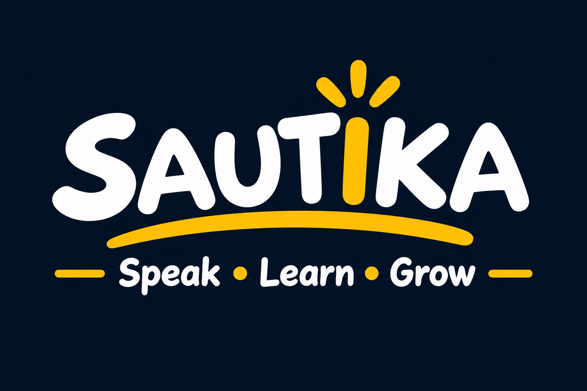
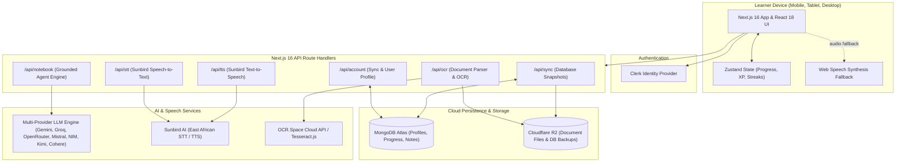
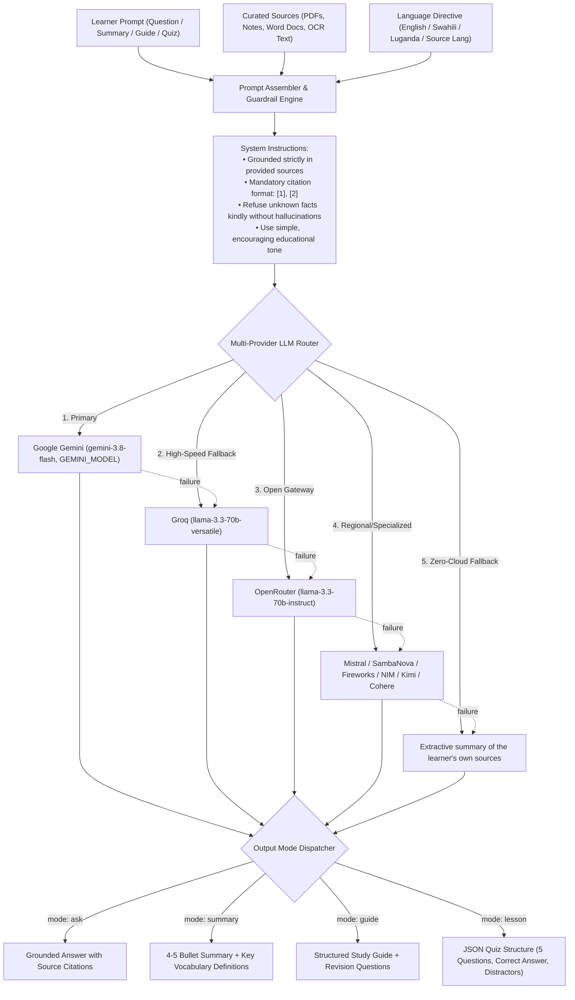
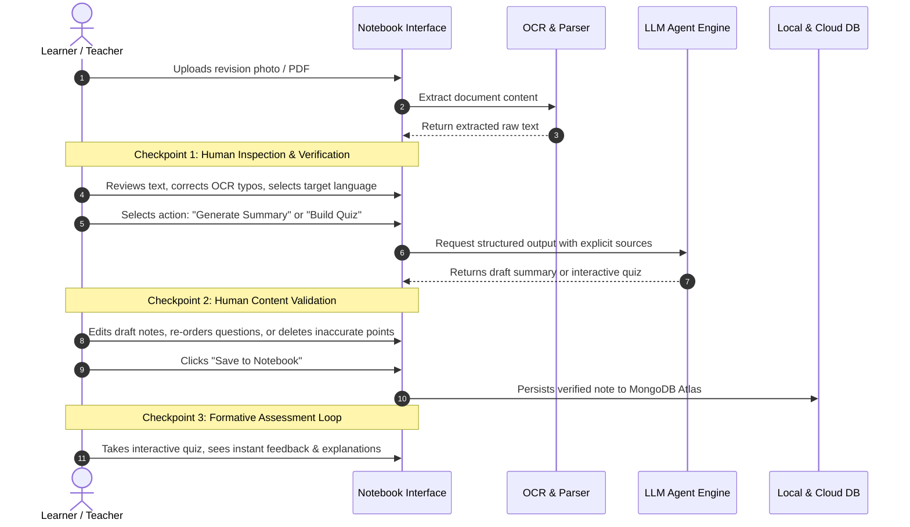

<p align="center">
  
</p>

<h1 align="center">Sautika</h1>

<p align="center">
  <strong>Speak • Learn • Grow</strong><br>
  An AI-assisted, voice-first learning platform and intelligent study assistant designed for learners across East Africa.
</p>

<p align="center">
  <a href="#problem-statement">Problem Statement</a> ·
  <a href="#solution-overview">Solution Overview</a> ·
  <a href="#target-users">Target Users</a> ·
  <a href="#architecture">Architecture</a> ·
  <a href="#technology-stack">Technology Stack</a> ·
  <a href="#agent-architecture">Agent Architecture</a> ·
  <a href="#mcp-implementation">MCP Implementation</a> ·
  <a href="#mcp-toolsservers">MCP Tools</a> ·
  <a href="#human-in-the-loop-workflow">Human-in-the-Loop</a> ·
  <a href="#security">Security</a> ·
  <a href="#setup--installation">Setup</a> ·
  <a href="#usage-instructions">Usage</a> ·
  <a href="#limitations">Limitations</a> ·
  <a href="#future-improvements">Roadmap</a>
</p>

---

## Problem Statement

Across East Africa, millions of primary and secondary school learners encounter steep barriers to equitable, high-quality education:

1. **Textbook & Learning Resource Shortages:** Many schools operate with severe student-to-textbook ratios. Students rely heavily on handwritten notebooks or photocopied pamphlets, making revision and self-directed study difficult.
2. **Linguistic Barriers:** While national examinations are administered in English, students frequently conceptualize foundational ideas in regional languages (such as Swahili or Luganda). Mainstream educational platforms lack native support for East African speech accents and indigenous languages.
3. **Connectivity & Device Constraints:** Intermittent internet access, expensive mobile data tariffs, and entry-level mobile devices restrict students from utilizing cloud-heavy modern AI learning software.
4. **Diverse Learning Needs & Reading Difficulties:** Learners with visual impairments, dyslexia, or varied cognitive learning paces are frequently overlooked by rigid, text-dense learning management systems.
5. **Passive Rather Than Active Study:** Passive rereading of notes produces low retention. Learners need interactive study tools—such as instant quizzes, structured summaries, and voice-assisted Q&A—grounded strictly in their actual school syllabus and revision notes.

---

## Solution Overview

**Sautika** (*from the Swahili word for voice/sound*) is an accessible, voice-first learning platform and AI study companion engineered specifically for the East African educational ecosystem. 

Sautika bridges the educational resource gap through:

- **Universal Document Ingestion & OCR:** Learners photograph physical revision sheets or upload Word documents (`.docx`), PDFs, and text files. Sautika extracts the text using cloud OCR and local fallback engines, summarizing key takeaways automatically.
- **Voice-First Regional Interaction:** Powered by Sunbird AI with a browser speech-synthesis fallback, learners dictate questions and listen to answers. The interface translates into 47 languages and 17 of them have a voice (Luganda, Swahili, Acholi, Ateso, Runyankole, Kinyarwanda and more).
- **Grounded AI Study Agent:** An intelligent notebook agent that answers questions cited strictly from uploaded sources (`[1]`), synthesizes revision guides, and dynamically generates 5-question interactive quizzes to test comprehension.
- **Offline-Resilient Architecture:** A service worker (`public/sw.js`) keeps the pages and lessons a learner has already opened, and a persisted Zustand store keeps settings and progress, syncing to MongoDB Atlas when the connection returns. API responses are never cached.
- **Curriculum Alignment:** 38 preloaded courses covering Baby Class through Senior 6 across Science, Math, Languages, Social Studies and Digital Literacy.
- **Inclusive Accessibility:** Built-in dyslexia-friendly typography (OpenDyslexic, Lexend, Atkinson Hyperlegible), text-to-speech reading assistance, color-tint reading overlays, and high-contrast themes.

---

## Target Users

| User Persona | Key Pain Points | How Sautika Helps |
| --- | --- | --- |
| **Primary & Secondary Students** | Limited revision textbooks, difficult terminology, exam anxiety | Practice interactive quizzes, transform handwritten notes into study guides, listen to pronunciation in regional languages. |
| **Bilingual / ESL Learners** | Conceptualizing in Swahili/Luganda but tested in English | Speech recognition and dual-language audio synthesis provide audio reinforcement in familiar accents. |
| **Learners with Dyslexia & Visual Difficulties** | Eye fatigue, text crowding, difficulty tracking sentences | Dyslexia fonts (OpenDyslexic, Lexend), customizable line spacing, reading tint overlays, and one-click voice narration. |
| **Teachers & Tutors** | Heavy workload preparing custom revision questions and summaries | Instant upload of syllabus notes to generate structured summaries, key vocabulary definitions, and interactive student quizzes. |
| **EdTech Developers & Researchers** | Scarcity of open-source tools tailored for African languages and low-bandwidth resilience | Open extensible architecture featuring Model Context Protocol (MCP) servers and multi-provider LLM failover. |

---

## Architecture

Sautika implements a hybrid client/edge architecture designed for maximum resilience, responsive local interaction, and zero-leak credential security:



### Data and Request Lifecycle

1. **Local-First Interaction:** Client-side updates (lesson completion, streak progression, note creation) write immediately to the persisted Zustand store.
2. **Server-Side Token Verification:** Authenticated requests to `/api/account` validate Clerk JWT sessions server-side before persisting data to MongoDB Atlas.
3. **Universal Document Extraction:** Uploaded PDFs, Word files, or captured photos route to `/api/ocr`. Text is extracted via `pdf-parse`, `mammoth`, or cloud `OCR.Space` (with local `tesseract.js` fallback), stored to Cloudflare R2, and summarized by the LLM engine.
4. **Grounded Agent Processing:** Queries to `/api/notebook` bundle learner sources into prompt context, passing through the multi-provider failover pipeline before returning grounded answers or quiz objects.
5. **Speech Synthesis:** Voice queries stream audio blobs to `/api/stt` for East African speech recognition; text responses can be synthesized into regional speech via `/api/tts`.
6. **Translation Routing:** `/api/translate` and `src/lib/translation.ts` pick a provider per language pair. For the languages Sunbird AI specialises in (Luganda, Acholi, Ateso, Lugbara, Runyankole, Lumasaba, Lusoga, Rukiga, Rukonjo, Ruruuli, Rutooro, Lendu, Kinyarwanda, Swahili, Dholuo, Kalenjin, Luhya) the order is **Sunbird → Google → LLM**; elsewhere it is **Google → Sunbird → LLM**. `TRANSLATION_PROVIDER_ORDER` overrides it. English results can be run through the LLM as a copy editor, and an edit more than 1.6× longer than the original is rejected as padding. Results are cached in memory, and interface labels are batched into roughly one request per screen and mirrored to `localStorage`.
7. **Offline Behaviour:** In production, `public/sw.js` serves page navigations network-first and keeps the newest 40 visited pages, serves static assets cache-first (newest 300), and falls back to `/offline.html`. `/api/*` and `/sso-callback` are never cached, and signing out clears the page cache so a shared phone does not keep the previous learner's pages.

---

## Technology Stack

| Category | Technology | Purpose |
| --- | --- | --- |
| **Framework & Runtime** | [Next.js 16 (App Router)](https://nextjs.org/) | Hybrid Server/Client components, dynamic routing, and `proxy.ts` |
| **Frontend Core** | [React 18](https://react.dev/), [TypeScript](https://www.typescriptlang.org/) | Type-safe reactive component tree and view layers |
| **Styling & Layout** | [Tailwind CSS 4](https://tailwindcss.com/) | Responsive layouts, CSS variable tokens, and dark/light mode themes |
| **Icons & Assets** | [Lucide React](https://lucide.dev/) | Clean, accessible vector interface iconography |
| **Typography & A11y** | [@fontsource](https://fontsource.org/) | Embedded dyslexia-accessible typefaces (OpenDyslexic, Lexend, Atkinson Hyperlegible, Comic Neue) |
| **Local Client State** | [Zustand](https://github.com/pmndrs/zustand) | Persisted reactive store for streaks, coin rewards, XP, and settings |
| **Authentication** | [Clerk](https://clerk.com/) (`@clerk/nextjs`) | Multi-factor user identity, session management, and protected routes |
| **Cloud Database** | [MongoDB Atlas](https://www.mongodb.com/atlas) (`mongodb`) | Cloud persistence of user profiles, progress, notes, and coin history |
| **Object Storage & Backup** | [Cloudflare R2](https://www.cloudflare.com/developer-platform/r2/) (`@aws-sdk/client-s3`) | S3-compatible cloud storage for uploaded documents and automated database sync snapshots |
| **Document Parsers** | `mammoth`, `pdf-parse` | Server-side text extraction from Microsoft Word documents and PDF files |
| **OCR Engines** | `OCR.Space API`, `tesseract.js` | Cloud API and local WebAssembly fallback for extracting text from note photos |
| **Speech Services** | [Sunbird AI](https://sunbird.ai/) & Web Speech API | East African regional speech-to-text (`/api/stt`) and text-to-speech (`/api/tts`) |
| **LLM Inference Engine** | Multi-Provider Failover Router | Resilient multi-tier routing across Google Gemini, Groq, OpenRouter, Mistral, SambaNova, Fireworks, NVIDIA NIM, Kimi, Zhipu, and Cohere |
| **Translation Router** | Sunbird AI, Google Cloud Translation v2, LLM | Per-pair routing with caching and optional English polishing |
| **Offline Layer** | Service worker + Web App Manifest | Caches visited pages and static assets; installable on Android |
| **AI Tooling Protocol** | [Model Context Protocol (MCP)](https://modelcontextprotocol.io/) | One import-free core served over stdio and Streamable HTTP, exposing curriculum, translation, speech, OCR and note tools |

---

## Agent Architecture

Sautika features a specialized **Grounded Educational Agent** embedded within the Learning Notebook (`/api/notebook` and `src/lib/llm-providers.ts`). The agent acts as an encouraging, patient tutor dedicated to East African learners.



### Agent Modes

1. **`ask` (Interactive Grounded Q&A):** Answers questions posed by the learner. Constrained strictly to the uploaded texts to prevent hallucinations, formatting citations as `[Source 1]`.
2. **`summary` (Digest Generation):** Distills complex chapters or document scans into 4–5 bullet points accompanied by 3 key vocabulary definitions suited for school-age comprehension.
3. **`guide` (Comprehensive Study Guide):** Generates a structured breakdown comprising 4 key concepts, 4 core terms with explanations, and 2 practice questions.
4. **`lesson` (Interactive Quiz Synthesis):** Emits strict JSON schemas containing 5 multiple-choice questions with answer keys and plausible distractors to convert any text into an interactive test player.

---

## MCP Implementation

Sautika ships a **[Model Context Protocol](https://modelcontextprotocol.io/)** server, so an assistant (Claude Code, Claude Desktop, Cursor, Antigravity) can work from the real curriculum instead of guessing at it.

Every tool, resource and prompt lives in one module, [`src/mcp/core.ts`](./src/mcp/core.ts), and two transports wrap it:

| Transport | Entry point | Run it with | For |
| --- | --- | --- | --- |
| stdio | [`scripts/sautika-mcp-server.mjs`](./scripts/sautika-mcp-server.mjs) | `npm run mcp` | An assistant on this machine |
| Streamable HTTP (JSON) | [`src/app/api/mcp/route.ts`](./src/app/api/mcp/route.ts) | `POST /api/mcp` | Remote clients, with or without a token |

`core.ts` has **no imports at all**. The courses, language list, search function, environment and `fetch` all arrive in a context object. That is what lets the same file run inside Next.js and directly under Node's native TypeScript type stripping, with no build step and no second copy of the logic to keep in sync.

### Protocol versions

`2026-07-28` (discovery only), `2025-11-25` (negotiated by default), `2025-06-18`, `2025-03-26`, `2024-11-05`.

- `server/discover` returns `supportedVersions`, capabilities, server info, instructions and a five-minute cache hint.
- `initialize` negotiates the client's version when it is supported, and falls back to `2025-11-25`.
- A request carrying an unsupported `_meta["io.modelcontextprotocol/protocolVersion"]` gets error `-32022` with the supported list in `data.supported`.
- Unknown method is `-32601`; an unknown tool or resource is `-32602`.
- Input and service failures come back as **tool results** with `isError: true`, not protocol errors, so the model can read the message and try again.

### Configuration

[`.mcp.json`](./.mcp.json) registers both transports for Claude Code:

```json
{
  "mcpServers": {
    "sautika": {
      "type": "stdio",
      "command": "node",
      "args": ["--no-warnings", "./scripts/sautika-mcp-server.mjs"]
    },
    "sautika-live": {
      "type": "http",
      "url": "https://sautika.vercel.app/api/mcp",
      "headers": { "Authorization": "Bearer ${SAUTIKA_MCP_TOKEN}" }
    }
  }
}
```

[`.agents/mcp_config.json`](./.agents/mcp_config.json) and [`.agents/plugins/ocr-service/mcp_config.json`](./.agents/plugins/ocr-service/mcp_config.json) register the same stdio server under the name `sautika` for agentic IDEs.

The stdio server reads `.env.local` and then `.env`, never overriding a variable that is already set, and needs **Node 22.18 or newer**.

---

## MCP Tools/Servers

### Server: `sautika` (v2.0.0)

- **Transports:** stdio and Streamable HTTP
- **Protocol:** JSON-RPC 2.0, MCP `2025-11-25` by default
- **Methods:** `server/discover`, `initialize`, `ping`, `tools/list`, `tools/call`, `resources/list`, `resources/templates/list`, `resources/read`, `prompts/list`, `prompts/get`

### Tools

Over HTTP, anonymous callers get the read-only curriculum tools. The ones that spend Sunbird, LLM or OCR quota need `Authorization: Bearer ${MCP_API_TOKEN}`.

| Tool | stdio | HTTP, no token | HTTP, token | What it does |
| --- | :---: | :---: | :---: | --- |
| `search_courses` | ✅ | ✅ | ✅ | Ranked search over the 38 courses; understands "fractions P.4" and "computers for senior three". Returns `structuredContent`. |
| `get_course` | ✅ | ✅ | ✅ | One course with every lesson, question and answer. |
| `get_lesson_quiz` | ✅ | ✅ | ✅ | The questions of one lesson, optionally translated. |
| `list_languages` | ✅ | ✅ | ✅ | All 47 languages, with a `voice` flag for the 17 Sunbird can speak. |
| `platform_status` | ✅ | ✅ | ✅ | Catalogue counts and which services are configured. Booleans only, never secrets. |
| `translate_text` | ✅ | — | ✅ | Sunbird → Google → LLM routing, with optional English polishing. |
| `text_to_speech` | ✅ | — | ✅ | Sunbird speech, returned as an audio URL. |
| `generate_quiz` | ✅ | — | ✅ | Multiple-choice questions from notes, each with two distractors and an explanation. |
| `summarize_notes` | ✅ | — | ✅ | A revision summary or a study guide, in the learner's language. |
| `ocr_extract_text` | ✅ | — | ✅ | Text from a photo of notes (https URL or data URI; stdio also accepts a local path). |
| `extract_document_text` | ✅ | — | — | Local only: reads `.txt`, `.md`, `.csv`, `.json`, `.docx` and `.pdf` from disk. |

Every tool declares a `title`, a strict `inputSchema` (`additionalProperties: false`) and annotations (`readOnlyHint`, `destructiveHint`, `idempotentHint`, `openWorldHint`). Nothing in this server writes to the platform.

### Resources

| URI | Contents |
| --- | --- |
| `sautika://curriculum` | Every course with subject, class, lesson and question counts |
| `sautika://languages` | Every language, with a `voice` flag |
| `sautika://courses/{course_id}` | One full course (also listed as a resource template) |

### Prompts

| Prompt | Arguments | Produces |
| --- | --- | --- |
| `lesson_plan` | `course_id` | A 40-minute plan: objectives, warm-up, teaching steps, a group activity with Ugandan examples, and an exit check drawn from the course questions |
| `explain_in_language` | `topic`, `language`, `level?` | A simple explanation in the chosen language, with a local example and a check question |
| `revision_session` | `course_id` | A 20-minute revision run through one course |

### Trying it

```bash
# stdio
printf '%s
' '{"jsonrpc":"2.0","id":1,"method":"tools/list"}' | npm run --silent mcp

# HTTP, anonymous: the five read-only tools
curl -X POST http://localhost:3000/api/mcp   -H 'content-type: application/json'   -d '{"jsonrpc":"2.0","id":1,"method":"tools/list"}'
```

`npm run mcp:inspect` opens the MCP Inspector against the stdio server, which lists all 11 tools.

---

## Human-in-the-Loop Workflow

Sautika is intentionally built around **learner and educator agency**. Rather than acting as an unguided autonomous agent, the platform enforces human-in-the-loop checkpoints across all AI workflows:



### Key Principles

1. **Explicit Source Curation:** The learner controls exactly which files and study units are supplied as grounding context. The agent never browses external unverified sources without instruction.
2. **Transparent Citations:** Answers to specific questions reference `[Source X]`, allowing learners and teachers to immediately cross-reference the answer with their original notes.
3. **Editable Drafts:** OCR extractions and AI-generated summaries open in editable text fields. Learners can modify, supplement, or rewrite points prior to saving.
4. **Safety and Fallback Guardrails:** If requested knowledge is absent from the user's provided notes, the agent is instructed to state that the material is not in the source rather than guessing or hallucinating facts.

---

## Security

| Area | What is enforced | Where |
| --- | --- | --- |
| **Sign-in** | `/api/notebook`, `/api/ocr`, `/api/stt`, `/api/tts` and `/api/account` require a Clerk session and return `401` without one | `src/lib/api-guard.ts` |
| **Rate limits** | Per user, per minute: notebook 15, OCR 10, speech-to-text 20, text-to-speech 30, translate 120 | `guardUser()` |
| **Anonymous translation** | `/api/translate` allows 30 requests per minute per IP so the landing page can translate itself; only signed-in callers may ask for `polishEnglish`, which spends LLM tokens | `src/app/api/translate/route.ts` |
| **Backup endpoints** | `/api/sync` needs `Authorization: Bearer ${SYNC_SECRET}` (or `CRON_SECRET`), compared in constant time, and returns `503` when neither is set | `requireCronSecret()` |
| **Database snapshots** | Sync snapshots are written under `mongodb-sync/` in R2, which must stay a **private** bucket prefix — it holds learner data | `src/lib/r2.ts`, `/api/sync` |
| **Uploads** | 10 MB cap, a per-user key prefix so one learner cannot read another's files, and only the types the OCR route can actually read | `/api/ocr` |
| **Coins** | Notes award coins at most 5 times a day, enforced server-side; the rewards page only advertises the rules the API enforces | `/api/account` |
| **MCP endpoint** | POST only, `Origin` checked against the host or `MCP_ALLOWED_ORIGINS`, 60 requests/min anonymously and 240 with a token; without `MCP_API_TOKEN` only the five read-only curriculum tools are visible | `src/app/api/mcp/route.ts` |
| **Service worker** | Never caches `/api/*` or `/sso-callback`, and clears the page cache on sign-out | `public/sw.js` |
| **Secrets** | API keys are read only on the server; `platform_status` and the status endpoints report booleans, never values | throughout |

> The rate limiter counts per serverless instance, so the real ceiling is `limit × instances`. It stops one client draining the Sunbird, OCR and LLM quotas; move it to Redis or Vercel KV when traffic justifies a cluster-wide guarantee.

---

## Setup / Installation

### Prerequisites

- **Node.js:** `20.9.0` or higher to run the app; `22.18.0` or higher for the MCP stdio server, which runs TypeScript directly
- **npm:** Package manager bundled with Node
- **MongoDB Atlas Cluster** (or local MongoDB instance)
- **mongosh:** (MongoDB Shell, optional for running initial schema scripts)

### Installation Steps

1. **Clone the repository:**
   ```bash
   git clone https://github.com/marthanp/sautika.git sautika-next
   cd sautika-next
   ```

2. **Install project dependencies:**
   ```bash
   npm install
   ```

3. **Configure Environment Variables:**
   Copy the example environment template:
   ```bash
   # Linux / macOS
   cp .env.example .env.local

   # Windows PowerShell
   Copy-Item .env.example .env.local
   ```
   Open `.env.local` and add your service credentials (see table below).

4. **Initialize MongoDB Database Schema:**
   *(Optional but recommended)* Run the database setup script to configure indexes and collection validators:
   ```powershell
   # Windows PowerShell
   $env:MONGODB_URI = "mongodb+srv://<username>:<password>@<cluster>.mongodb.net/?retryWrites=true&w=majority"
   mongosh "$env:MONGODB_URI" --file .\database\sautika.mongodb.js
   ```

5. **Start the Development Server:**
   ```bash
   npm run dev
   ```
   Open [http://localhost:3000](http://localhost:3000) in your browser.

---

### Environment Variables

| Variable | Description | Required? |
| --- | --- | --- |
| `NEXT_PUBLIC_CLERK_PUBLISHABLE_KEY` | Clerk authentication publishable key | Yes |
| `CLERK_SECRET_KEY` | Clerk backend secret key | Yes |
| `MONGODB_URI` / `MONGO_URI` | MongoDB Atlas connection string | Yes |
| `R2_ENDPOINT` | Cloudflare R2 S3 endpoint (`https://<account-id>.r2.cloudflarestorage.com`) | Optional |
| `R2_ACCESS_KEY_ID` | Cloudflare R2 Access Key ID | Optional |
| `R2_SECRET_ACCESS_KEY` | Cloudflare R2 Secret Access Key | Optional |
| `R2_BUCKET_NAME` | Cloudflare R2 bucket name (default: `sautika-media`) | Optional |
| `R2_PUBLIC_URL` | Public access URL for stored documents (e.g., `https://pub-<id>.r2.dev`) | Optional |
| `SUNBIRD_API_KEY` | Sunbird AI token for regional voice STT/TTS | Optional |
| `OCR_SPACE_API_KEY` | Primary API key for OCR.Space cloud document extraction | Optional |
| `OCR_SPACE_API_KEY_FALLBACK` | Secondary API key for OCR.Space | Optional |
| `GEMINI_API_KEY` / `GOOGLE_API_KEY` | Google Gemini API key for notebook AI tutor | Optional |
| `GROQ_API_KEY` | Groq API key for high-speed Llama-3.3 inference | Optional |
| `OPENROUTER_API_KEY` | OpenRouter API key for backup multi-model routing | Optional |
| `MISTRAL_API_KEY` | Mistral AI API key for failover | Optional |
| `GEMINI_MODEL` / `GROQ_MODEL` | Override the default models (`gemini-3.8-flash`, `llama-3.3-70b-versatile`) | Optional |
| `GOOGLE_TRANSLATE_API_KEY` | Google Cloud Translation v2 key. Enable the Cloud Translation API, then restrict the key to it | Optional |
| `TRANSLATION_ENGLISH_POLISH` | `true` to run English translations through the LLM as a copy editor | Optional |
| `TRANSLATION_PROVIDER_ORDER` | Force a routing order, e.g. `google,sunbird,llm` | Optional |
| `SYNC_SECRET` / `CRON_SECRET` | Bearer secret for the backup endpoints (`/api/sync`) | Required for sync |
| `MCP_API_TOKEN` | Unlocks the full tool set on `POST /api/mcp`. Generate: `node -e "console.log(require('node:crypto').randomBytes(32).toString('hex'))"` | Optional |
| `MCP_ALLOWED_ORIGINS` | Comma-separated origins allowed to call `/api/mcp` from a browser | Optional |

> **Note:** Sautika degrades rather than breaks. With no LLM key, Summarise falls back to an extractive summary of the learner's own notes (never a summary of the instructions). Voice falls back to the browser's Web Speech voices, and OCR falls back to local `tesseract.js`. Quizzes are the one feature that genuinely needs an LLM key, and they say so.

---

## Usage Instructions

### 1. Curriculum Exploration & Quizzes
- Navigate to **Courses** from the sidebar.
- Filter by grade level (from **Baby Class** up to **Senior 6**) and subject (**Science**, **Math**, **Languages**, **Social Studies**, **Digital Literacy**).
- Search the way you would speak: "fractions P.4", "computers for senior three" or "I want to learn about fractions" all find the right course.
- Click any course card to launch the **Lesson Player**.
- Complete multiple-choice exercises, receive immediate audio and visual feedback, and earn XP and learning coins.

### 2. Universal Document Upload & OCR
- Go to **Notebook** and click **Upload File** (or drag and drop a file).
- Supported formats:
  - **Photos of handwritten or textbook notes:** `.png`, `.jpg`, `.jpeg`, `.webp`
  - **Documents:** `.pdf`, `.docx`
  - **Plain Text:** `.txt`, `.md`, `.csv`, `.json`
- Sautika extracts the text, saves a backup copy to Cloudflare R2, and opens a **review** modal titled "Check your uploaded notes". Nothing is saved until you have read the text and pressed save, because OCR of handwriting is never perfect.

### 3. AI Study Tutor
- Open **Notebook**. The **AI Study Tutor** panel sits above your notes.
- Pick up to 8 notes as sources, then choose what to do:
  - **Summarise:** 4–5 bullet points with citations, plus 3 words to know.
  - **Study guide:** key ideas, core terms and practice questions with answers.
  - **Quiz me:** a 5-question quiz with instant feedback, an explanation per answer and a final score.
  - **Ask a question:** type a question and get an answer built only from the notes you picked.
- Answers cite their source as a small superscript `[1]`, in the language chosen in the header.
- **Listen** reads the answer aloud (Sunbird voice, or the browser voice as a fallback), and **Review and save as note** opens the note editor pre-filled so you can check it before it is saved.

### 4. Voice Interaction & Regional Speech
- Click the microphone icon to speak your question using Sunbird AI speech-to-text.
- Click the speaker icon on any note, question, or vocabulary term to hear audio synthesis in regional languages (Luganda, Swahili, or English).

### 5. Tracking Progress & Accessibility Customization
- Visit **Progress** to review learning streaks, subject mastery breakdowns, and earned badges.
- Visit **Settings** to adjust font scale, letter spacing, line height, contrast mode, dyslexia-friendly fonts, or reading tint overlays.

---

## Available Scripts

| Command | Description |
| --- | --- |
| `npm run dev` | Starts local Next.js dev server |
| `npm run build` | Builds optimized production bundle |
| `npm run start` | Starts production server |
| `npm run typecheck` | Validates TypeScript types across the project |
| `npm run lint` | Runs ESLint code style and quality checks |
| `npm run mcp` | Starts the Sautika MCP server over stdio (needs Node 22.18+) |
| `npm run mcp:inspect` | Opens the MCP Inspector against the stdio server |
| `npm run icons` | Regenerates the PWA icons from `public/Logo_symbol.png` |

---

## Project Structure

```text
sautika-next/
├── .agents/                 # MCP server registration for agentic IDEs
├── database/                # MongoDB schema, validators and index setup script
├── docs/
│   ├── architecture/        # Agent & MCP architecture diagram (SVG, PNG, printable HTML)
│   └── SAUTIKA_UPGRADE_PLAN.md  # Upgrade plan and roadmap notes
├── public/                  # Static assets served as-is (logos, images, web manifest)
├── scripts/                 # Standalone Node scripts (MCP server, PWA icon generator)
├── src/
│   ├── app/                 # Next.js App Router
│   │   ├── (app)/           # Authenticated learner area (home, courses, learning, notebook, …)
│   │   ├── api/             # Route handlers (account, notebook, ocr, stt, tts, translate, sync)
│   │   └── …                # Landing page, auth and policy routes
│   ├── components/
│   │   ├── auth/            # Sign-in form
│   │   ├── landing/         # Marketing page sections
│   │   ├── layout/          # App shell, sidebar, topbar, footer, policy page template
│   │   ├── providers/       # Cross-app state sync (learner data, accessibility)
│   │   ├── ui/              # Shared primitives, icons and logo
│   │   └── voice/           # Voice search, dialect selector and audio visualisers
│   ├── data/                # Static curriculum and catalog content
│   ├── hooks/               # Reusable React hooks
│   ├── lib/                 # Server/client utilities (MongoDB, R2, LLM router, translation router, course search, API guards)
│   ├── mcp/                 # Import-free MCP core shared by both transports
│   ├── store/               # Zustand store
│   ├── types/               # Shared TypeScript types
│   └── proxy.ts             # Clerk request proxy (Next.js 16 middleware)
├── AGENTS.md                # Agent instructions (managed by `next dev`, must stay at the root)
└── README.md
```

---

## Limitations

- **Handwriting Legibility:** Highly cursive, faint, or low-resolution photographs of handwritten notes may require manual correction after OCR extraction.
- **Regional Dialect Breadth:** While Sunbird AI provides state-of-the-art coverage for Swahili and Luganda, smaller East African dialects currently rely on English or Swahili phonetic synthesis.
- **Internet Dependency for Full Voice:** High-quality regional voice synthesis requires an active connection to Sunbird AI; offline devices fall back to the browser's built-in Web Speech voices.
- **Token Quotas on Free LLM Tiers:** Heavy concurrent usage of external AI providers may exceed rate limits, though Sautika mitigates this via multi-provider failover and heuristic generators.

---

## Future Improvements

- [ ] **Curriculum Semantic Search:** Integration of PostgreSQL with `pgvector` for semantic syllabus retrieval across East African national curriculum textbooks.
- [x] **Progressive Web App (PWA):** Service worker caching of visited pages and lessons, an offline page, and installation onto Android and low-cost smartphones.
- [ ] **Offline lesson packs:** Let a learner pick a course and keep its whole lesson set on the phone before going offline.
- [ ] **On-Device Edge AI:** Integration of WebLLM or compact on-device models to provide offline summaries and quiz generation without requiring cloud API calls.
- [ ] **Classroom & Teacher Dashboard:** Group assignment distribution, class analytics, and synchronized offline homework grading.
- [ ] **Additional Regional Languages:** Extending speech-to-text and text-to-speech models to include Runyankole, Acholi, and Ateso.

---

## Maintainers

Sautika is designed and maintained by:

- **NATOZO PATIENCE MARTHA**
- **EGABO AARON**
- **ONYANGO JOHN STEVEN**

---

## License

This project is licensed under the [MIT License](./LICENSE).
